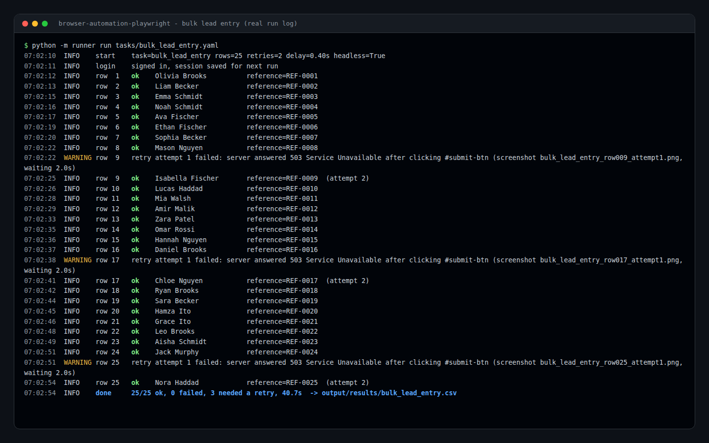
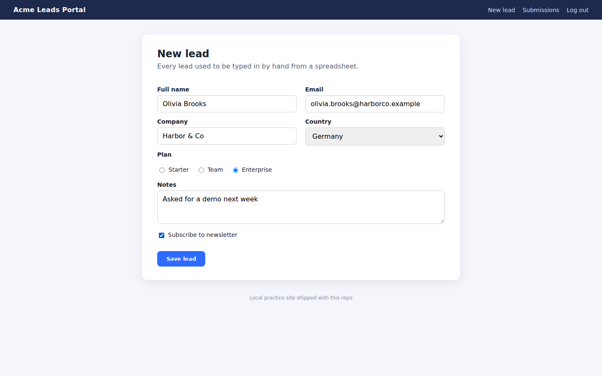
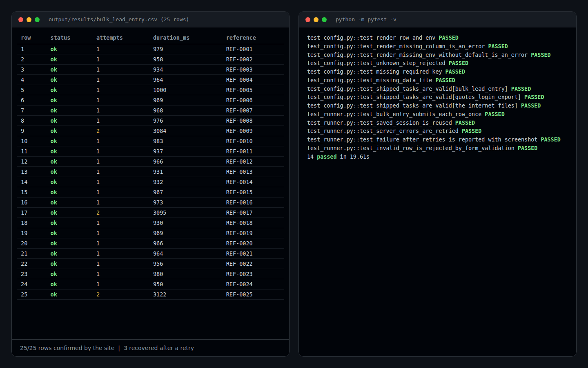

# browser-automation-playwright

Write the clicks down once in a short YAML file, and Playwright repeats them for every row of your spreadsheet: logins, form filling, downloads and uploads, with retries and a full log.



## What it does

- **Tasks in YAML, not code.** Each step is one line: `goto`, `fill`, `select`, `click`, `check`, `upload`, `download`, `wait_for`, `expect_text`, `extract`, `extract_all`, `screenshot`.
- **One run per CSV row.** `{{row.column}}` placeholders pull values from your CSV; `{{env.NAME|default}}` pulls credentials from environment variables so they never live in the task file.
- **Logs in once.** The login session is saved (`storage_state`) and reused on the next run; the runner signs in again only when the saved session has expired.
- **Waits for the page instead of sleeping.** Every step waits for its element. `expect_text` confirms the site actually accepted the row before moving on.
- **Retries with a screenshot of each failure.** A failed row is retried with backoff (`retries`, default 2). Every failed attempt saves a screenshot to `output/failures/`.
- **Polite by default.** A delay between rows (`rate_limit_seconds`) keeps the load on the site low.
- **Results you can audit.** Each run writes a timestamped log (`output/logs/`) and a results CSV with status, attempts, timing and any captured values (for example the confirmation number).
- **Headless or visible.** `--headed` shows the browser; `--slow-mo 300` slows it down for a walkthrough.

## Use it only where you are allowed to

Automate only websites you own, have written permission to automate, or that are built for practice. Respect each site's terms of service and robots rules. This project does **not** solve or bypass CAPTCHAs, rotate identities, or evade bot detection, and it should not be used for that.

The three demo tasks run against:
- `mock_site/`: a small Flask "leads portal" that ships with this repo.
- [quotes.toscrape.com](https://quotes.toscrape.com) and [the-internet.herokuapp.com](https://the-internet.herokuapp.com): public sites made for automation practice.

## Quick start

```bash
git clone https://github.com/Ali83128/browser-automation-playwright.git
cd browser-automation-playwright
python -m venv .venv && source .venv/bin/activate      # Windows: .venv\Scripts\activate
pip install -r requirements-dev.txt
python -m playwright install chromium
```

## The three demo tasks

### 1. Bulk form entry from a CSV (`tasks/bulk_lead_entry.yaml`)

The task signs in to the local leads portal, then types each of the 25 leads in `data/leads.csv` into the "New lead" form. That includes the text fields, a dropdown, a radio button and a checkbox. It waits for the confirmation and records the reference number.

```bash
python -m mock_site                                   # terminal 1, http://127.0.0.1:5055 (demo / demo123)
python -m runner run tasks/bulk_lead_entry.yaml       # terminal 2
```

To see the retries work, start the site with `MOCK_FLAKY_EVERY=9 python -m mock_site`. Every 9th submission then gets a `503`. The run in the screenshot above used this setting: 25/25 leads were saved and 3 needed a retry. The site recorded 25 submissions with no duplicates.



### 2. Log in and export data (`tasks/quotes_login_export.yaml`)

The task signs in and checks it is logged in. It then follows the "Next" link through every page and saves all records to `output/exports/quotes.csv` and `.json`. The real run collected 100 quotes from 10 pages. The second run reused the saved session and skipped the login form.

```bash
python -m runner run tasks/quotes_login_export.yaml
```

### 3. Files, dynamic content and controls (`tasks/the_internet_files.yaml`)

The task works through four pages:
- downloads a file and records its name and size
- uploads `data/upload_sample.txt` and confirms the server's "File Uploaded!" message
- waits for content that only loads after a click
- ticks a checkbox and picks a dropdown option

```bash
python -m runner run tasks/the_internet_files.yaml
```

## Writing your own task

```yaml
name: my_task
base_url: https://example.com
data: data/rows.csv                 # optional: run the steps once per row
storage_state: output/state/my.json # optional: remember the login between runs
retries: 2
rate_limit_seconds: 1.0

login:                               # optional
  check_url: /dashboard
  logged_in_selector: 'a.logout'
  steps:
    - goto: /login
    - fill: { selector: '#email', value: '{{env.SITE_EMAIL}}' }
    - fill: { selector: '#password', value: '{{env.SITE_PASSWORD}}' }
    - click: 'button[type=submit]'

steps:
  - goto: /orders/new
  - fill: { selector: '#customer', value: '{{row.customer}}' }
  - select: { selector: '#status', value: '{{row.status}}' }
  - check: { selector: '#urgent', if: '{{row.urgent}}' }
  - click: '#save'
  - expect_text: { selector: '.alert-success', contains: 'Saved' }
  - extract: { name: order_id, selector: '#order-id' }

output: output/results/my_task.csv
```

`python -m runner check tasks/my_task.yaml` validates a file without opening a browser. Useful flags:

| Flag | Effect |
|---|---|
| `--headed` | show the browser window |
| `--limit N` | only the first N CSV rows (good for a dry test) |
| `--base-url URL` | point the same task at staging or production |
| `--slow-mo MS` | slow each action down for a walkthrough |
| `-v` | debug logging |

## Tests

```bash
python -m pytest -v
```

There are 14 tests. They start the bundled mock site on a random local port and drive a real headless Chromium against it, so no internet connection is needed. They check that:
- every field reaches the server exactly as it appears in the CSV
- a saved session is reused instead of logging in again
- `503` errors are retried without creating duplicate records
- a row that keeps failing is reported with a screenshot of each attempt
- the form's own validation rejects a bad row
- task files are validated before anything runs



## Project layout

```
runner/          config.py (YAML + placeholders), steps.py (step library), engine.py (session, retries, logs), cli.py
mock_site/       local Flask practice site used by the demo and the tests
tasks/           the three demo tasks
data/            leads.csv (25 fictional leads), upload_sample.txt
output/          results/, exports/, screens/ from the real runs (logs, failures and saved sessions are git-ignored)
docs/            screenshots and the full log of the bulk run (sample_run_log.txt)
scripts/         capture_screenshots.py rebuilds the screenshots from a real run
tests/           pytest suite
```

## Need something automated?

I build browser automations like this for back-office work: data entry from spreadsheets, report downloads, portal uploads and form workflows. Available on Upwork.

## License

MIT © 2026 Ali Riaz
